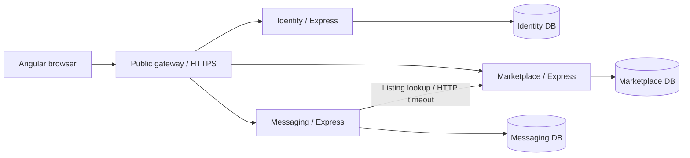

# Service boundaries and API

Each service can be deployed and restarted independently. A common image contains the service code; `SERVICE` selects the process. Logical databases are separate on one cluster to reduce lab costs. Separate database users scoped to their own databases should replace the shared local root credential for a hardened deployment. There are no cross-service database queries or distributed transactions. Listing and offers share one aggregate/document so accepting an offer is atomic without a distributed transaction. Messaging checks conversation eligibility over authenticated HTTP. A buyer must send an offer before starting a thread, so sellers can find all conversations from My exchanges. This synchronous architecture intentionally omits queues; a failed dependency returns an error rather than fabricating a result.

| Method   | Path                         | Access / result                               |
| -------- | ---------------------------- | --------------------------------------------- |
| POST     | /api/auth/register           | email, password, alias → 2-hour bearer token  |
| POST     | /api/auth/login              | email, password → token                       |
| GET      | /api/auth/me                 | authenticated public profile                  |
| GET      | /api/items?category=&q=      | public listings (max 200)                     |
| GET      | /api/items/:id               | public listing, no offers                     |
| POST     | /api/items                   | authenticated listing, price in integer paise |
| GET      | /api/workspace               | own listings, offers and sales (max 200)      |
| POST     | /api/items/:id/offers        | authenticated amount in paise                 |
| POST     | /api/items/:id/accept/:offer | seller only, available → sold                 |
| GET/POST | /api/messages/:id            | buyer’s thread; seller supplies ?buyer=ID     |
| GET      | /healthz                     | process liveness                              |
| GET      | /readyz                      | domain-service database readiness             |

Registration uses scrypt with a random salt. Tokens carry subject and public alias, never email/password; issuer, audience, signature, expiry and algorithm are verified in every service. The browser retains its token in sessionStorage, so XSS prevention remains important; signing out removes it locally, but a copied token remains valid until expiry. There is no refresh or server-side logout/revocation in this edition. A common JWT key is an explicit lab tradeoff: a compromised service could sign tokens. A later exercise can replace it with asymmetric signing and public verification keys.

User identity comes from the verified token, never a request-body user ID. Inputs are bounded and parsed, Mongo queries use explicit fields, and errors hide database details. HTTP timeouts and per-process rate limits bound abuse; limits are not distributed, so Azure lab deployments use a maximum of one replica per app. Browser/API use one origin through the gateway, avoiding credentialed cross-origin requests. Bearer headers are explicit; cookies are not used for auth. Do not log tokens, passwords, messages or connection strings.

All images are HTTPS links rendered by the browser with no referrer. Services do not fetch arbitrary photo URLs. External image hosts still receive the viewer’s network request. Message lists are newest-first and capped at 100; listings/workspaces are capped at 200, with no pagination UI yet. One offer per buyer and 50 offers per item bound document growth. Email verification, recovery, moderation, reporting and deletion workflows are needed before opening this to a general public marketplace.
